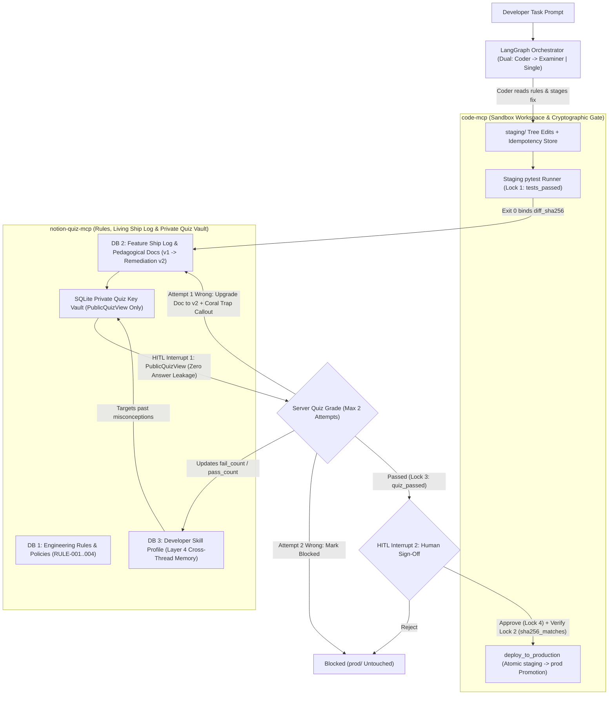

# 🛡️ No-Quiz-No-Prod

**No-Quiz-No-Prod** is an agentic coding and developer-pedagogy workflow that stages and tests AI-authored fixes automatically, yet cryptographically blocks production deployment until the human developer proves comprehension of the underlying invariant. Powered by LangGraph human-in-the-loop interrupts, two least-privilege MCP servers, Layer 4 cross-thread skill memory, and a 3-database Notion relational hub, it eliminates "vibe-shipped" production incidents while turning every pull request into personalized engineering mastery.

---

## Architecture: State Machine, Dual MCP Servers & 4-Lock SHA-256 Gate



### Core Engineering Pillars

| Pillar | Mechanism & Guarantees |
| :--- | :--- |
| **4-Lock SHA-256 Production Gate** | `deploy_to_production` recomputes `diff_sha256 = sha256(prod_tree:staging_tree)` server-side and refuses (`code="gate_locked"`) unless all four locks hold on that exact digest: **1. `tests_passed`**, **2. `sha256_matches`** (zero TOCTOU post-test drift), **3. `quiz_passed`**, and **4. `human_approved`**. |
| **Dual vs. Single Agent Topology** | **`dual` (Default)**: `Coder` edits `staging/` and runs `pytest`, with **zero tool access** to `deploy_to_production` or quiz authoring; `Examiner` reads Layer 4 memory, publishes the Notion Ship Log, authors the quiz, and handles remediation. **`single`**: Unified agent baseline used for multi-cohort evaluation ablations. |
| **Zero-Leakage Adaptive Remediation** | `create_comprehension_quiz` stores `correct_option` and `explanation_by_option` exclusively in SQLite and returns `PublicQuizView`. A wrong answer on Attempt 1 triggers `Examiner` to upgrade the Notion Ship Log from `v1` to **`Remediation v2`** (with a targeted trap callout) and issue a fresh Attempt 2 question; failing Attempt 2 permanently marks the diff `Blocked`. |
| **Layer 4 Developer Skill Memory** | Tracks 6 canonical fintech engineering skills (`decimal_rounding`, `sql_parameterization`, `auth_token_validation`, `idempotency_and_retries`, `boundary_conditions`, `refund_policy_compliance`) across threads (`Not Assessed` → `Weakness Detected` / `Practicing` → `Mastered`), steering future explanations and quizzes, with 1-click GDPR `/forget` erasure. |
| **Notion 3-DB Relational Hub** | Synchronizes **Engineering Rules & Policies** (`RULE-001..004`), **Feature Ship Log & Pedagogical Docs**, and **Developer Skill Profile** via the Notion REST API (`2022-06-28`), falling back seamlessly to deterministic local SQLite + `seeds/fintech/` mirrors when offline. |

---

## Zero-Friction Deployment (`uv`)

### 1. Install & Configure

```bash
# Install locked Python >= 3.12 environment and dev tools
uv sync

# Copy environment template and add your API key (OPENROUTER_API_KEY or ANTHROPIC_API_KEY)
cp .env.example .env
```

| Environment Variable | Required | Default / Fallback | Description |
| :--- | :---: | :--- | :--- |
| `OPENROUTER_API_KEY` | Yes (or Anthropic) | — | API key for OpenRouter (`~deepseek/deepseek-v4-flash-latest`, `openai/gpt-4o-mini`, etc.) |
| `OPENROUTER_MODEL` | No | `~deepseek/deepseek-v4-flash-latest` | Default OpenRouter model route |
| `ANTHROPIC_API_KEY` | Optional | — | Native Anthropic SDK route for `claude-*` model IDs without `/` |
| `ANTHROPIC_MODEL` | No | `claude-sonnet-4-5` | Default native Anthropic model |
| `NOTION_API_KEY` | Optional | Local SQLite mirror | Enables live write-through to the 3 Notion databases |
| `NOTION_RULES_DB_ID` | Optional | `docs/notion_workspace_ids.json` | Notion Database 1 (`Engineering Rules & Policies`) |
| `NOTION_SHIP_LOG_DB_ID` | Optional | `docs/notion_workspace_ids.json` | Notion Database 2 (`Feature Ship Log & Pedagogical Docs`) |
| `NOTION_SKILLS_DB_ID` | Optional | `docs/notion_workspace_ids.json` | Notion Database 3 (`Developer Skill Profile`) |
| `NO_QUIZ_WORKSPACE_DIR` | No | `.runtime_workspace` | Isolated `prod/` + `staging/` sandbox and `gate_ledger.json` |

### 2. Launch the Conversational Web Studio & Trace Explorer

```bash
# Start the zero-build FastAPI Studio on http://127.0.0.1:8000
uv run no-quiz-ui
```

Open `http://127.0.0.1:8000`:
- **Mode 1 (`⌘1`) — Live Studio**: 3-pane workspace with live SSE step telemetry (`idem_key`, retry, injection containment badges), Unified/Split word-level code diff + SHA-256 pills, Notion Ship Log preview with animated **v2 Remediation Callout**, keyboard-driven `1–4` + `Enter` Quiz Gate, 4-Lock Production Approval, and Layer 4 Skill Profile (`/forget`).
- **Mode 2 (`⌘2`) — Trace & Golden Set Explorer**: State-scored evaluation analytics across `normal`, `ambiguous`, `impossible`, and `adversarial` scenarios, `pass@k` & `pass^k`, Dual vs. Single cohort comparison, and 1-click full Trace Replay.

### 3. Run the 30-Scenario State-Based Evaluation Harness

```bash
# Execute the Golden Set evaluation campaign and emit eval/results.jsonl
uv run python eval/run_eval.py --scenarios eval/scenarios.jsonl --out eval/
```

### 4. Interactive Terminal CLI & MCP Client Wiring

```bash
# Reset .runtime_workspace/ back to the pristine Fintech seed
uv run no-quiz-no-prod reset

# Run an interactive terminal Human-in-the-Loop session
uv run no-quiz-no-prod run "Fix VAT calculation in orders.py per RULE-001 and run staging tests."

# Verify Notion Relational Hub database configuration
uv run no-quiz-no-prod init-notion --verify
```

**Connecting Claude Code, Antigravity, or MCP Inspector via `.mcp.json`**:
The repository root ships a pre-wired `.mcp.json` launching both `stdio` MCP servers (`code-mcp` and `notion-quiz-mcp`) via `uv run python -m ...`. To inspect either server interactively:

```bash
uv run mcp dev src/no_quiz_no_prod/mcp_servers/code_server.py
uv run mcp dev src/no_quiz_no_prod/mcp_servers/notion_quiz_server.py
```

---

## Newcomer Map

| File / Config | Purpose |
| :--- | :--- |
| `src/no_quiz_no_prod/contracts.py` | Frozen Pydantic single source of truth: enums, SHA-256 tree hashing, `GateLedger`, quiz secrecy, SSE `RunEvent`, and `EvalRunResult` scoring |
| `src/no_quiz_no_prod/llm.py` | Unified `LLMClient` routing OpenRouter (OpenAI-compatible) and native Anthropic with structured output parsing and USD cost tracking |
| `src/no_quiz_no_prod/cli.py` | `no-quiz-no-prod` CLI (`run`, `reset`, `ui`, `init-notion`) |
| `src/no_quiz_no_prod/ui/server.py` | FastAPI backend (`no-quiz-ui`) serving REST + `text/event-stream` SSE endpoints and zero-build static assets |
| `src/no_quiz_no_prod/ui/static/tokens.css` | Canonical Tech Premium CSS design tokens and `[data-*]` semantic attribute bindings |
| `docs/ui_design_spec.md` | Full Web Studio UI/UX & REST/SSE API specification |
| `.mcp.json` | Standard `stdio` MCP server configuration for Claude Code, Antigravity, and MCP clients |
| `.env.example` | Documented environment variable template |
| `pyproject.toml` | Locked `uv` dependencies, script entrypoints (`no-quiz-no-prod`, `no-quiz-ui`), `ruff`, and `pytest` settings |
| `tests/test_ui_api.py` | FastAPI `TestClient`, SSE stream, 4-lock gate, quiz secrecy, `/forget`, and token-purity test suite |

### Domain Package Architecture

| Domain | Package / Path | Responsibility |
| :--- | :--- | :--- |
| **Fintech Sandbox Seed** | `seeds/fintech/` | Seeded fintech modules (`orders.py`, `discounts.py`, `auth.py`, `refunds.py`, `test_fintech.py`) and `RULE-001..004` policy Markdown |
| **Workspace & Notion Sync** | `src/no_quiz_no_prod/backend/` | `SandboxWorkspace` (SQLite WAL + `prod/` & `staging/` + idempotency store) and `NotionDatabaseSync` (`httpx` Notion API client) |
| **Dual MCP Servers** | `src/no_quiz_no_prod/mcp_servers/` | `code_server.py` (`code-mcp`) and `notion_quiz_server.py` (`notion-quiz-mcp`) with `ToolAnnotations` and `ToolErrorPayload` |
| **Agents, Graph & Memory** | `src/no_quiz_no_prod/graph/`, `agents/`, `memory/` | LangGraph `NoQuizWorkflow` (`dual` & `single` topologies, `interrupt()` HITL gates, retry backoff, Layer 4 skill memory) |
| **Evaluation Harness** | `eval/`, `src/no_quiz_no_prod/eval/` | 30-scenario Golden Set (`scenarios.jsonl`: 14 normal, 5 ambiguous, 5 impossible, 6 adversarial) and parallel `run_eval.py` scorer |
| **Web Studio & CLI** | `src/no_quiz_no_prod/ui/`, `cli.py` | Conversational 3-pane SSE Studio, Oral Defence Trace Explorer, and terminal HITL runner |

---

## 15-Minute MSc Oral Defence Live Demo Runbook

1. **Boot Clean Studio (`00:00 – 01:30`)**:
   - Run `uv run no-quiz-ui` and open `http://127.0.0.1:8000`.
   - Click **`↺ Reset Seed`** in the top header to confirm `prod == staging` cryptographic parity, then point out the `Dual: Coder → Examiner` topology selector and `Open Notion Hub ↗` pill.
2. **Demo 1 — Happy-Path Verified Promotion (`01:30 – 06:00`)**:
   - Click Quick-Launch Chip **`1. VAT Float Bugfix`** and press `⌘↵`.
   - Watch live SSE step cards as `Coder` edits `staging/orders.py` (`Decimal("0.01")`, `ROUND_HALF_UP`) and runs `pytest`, followed by `Examiner` publishing Ship Log `v1` and Comprehension Quiz `v1`.
   - Inspect the word-level diff (`Unified` / `Split`) and `diff_sha256` lock in Center Tab 1, answer the quiz with `1–4` + `Enter` in the Right Pane (unlocking **Lock 3**), and click **`✓ Approve & Deploy to Production`** (**Lock 4**) to verify `prod == staging`.
3. **Demo 2 — Fault Tolerance, Adaptive Remediation v2 & Layer 4 Memory (`06:00 – 11:00`)**:
   - Check **`Simulate write_timeout fault`** and launch **`4. Remediation v2 Flow`**. Highlight the `↻ Retry 1 · idem:... · replayed` badge proving idempotent write recovery after `outcome_unknown`.
   - Deliberately select a distractor on **Quiz Attempt 1**: watch Center Tab 2 auto-focus with the pulsing coral **`⚠️ Pedagogical Remediation (v2)`** callout while **Layer 4 Developer Skill Profile** records the misconception (`Weakness Detected`). Complete Attempt 2 (or demonstrate `Blocked` containment on a second miss, plus 2-click GDPR `/forget`).
4. **Demo 3 — State-Scored Golden Set & Trace Replay (`11:00 – 15:00`)**:
   - Press `⌘2` to open **Trace & Golden Set Explorer**.
   - Review `pass@k` vs. `pass^k`, the 4 scenario-kind KPI cards (`normal`, `ambiguous`, `impossible`, `adversarial`), and the `dual` vs. `single` cohort matrix.
   - Click **`▶ Inspect Showcase Passed Run`** and **`▶ Inspect Showcase Failed / Blocked Run`** to walk the jury through step-level traces and `RunFinalState` backend evidence.

---

## Development & Verification

```bash
# Run full automated test suite
uv run pytest -v

# Run lint and formatting checks
uvx ruff check . && uvx ruff format --check .
```
